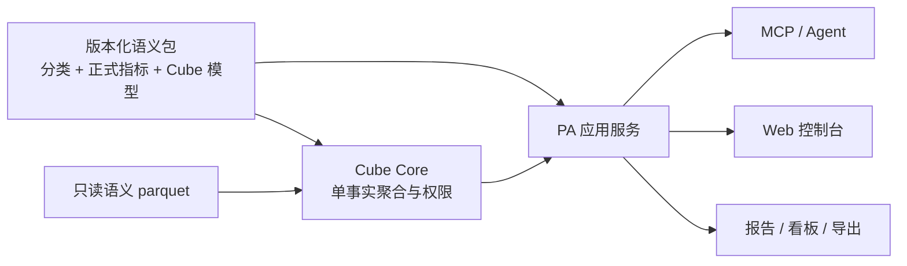

# PA — People Analytics Service

PA 是一个面向组织与人才数据的语义分析服务。它把人员规模、流动和编制等指标组织成受控的语义目录，让 Agent、控制台和 MCP 客户端通过“指标 × 维度 × 时间 × 过滤”查询，而不是直接生成 SQL。

仓库默认运行完全虚构、可重复生成的 Demo 数据，不依赖任何企业内部数据、字段映射或系统。

## 它展示什么

- 各自独立的宽事实表：Cube Core + DuckDB 直接汇总 parquet，查询时不把不同事实表的原始行连接起来。
- 正式指标依赖图：跨事实表的比率由 TypeScript Planner 拆成多个单表子查询，各自汇总后对齐并重新计算。
- 只允许预定义的查询：MCP adapter 只做协议转换，不开放 SQL，也不接受临时定义的指标。
- 先按权限过滤再组装目录：一个正式指标只有在它的全部基础指标都对当前用户可见时，才出现在目录里。
- 一套应用代码，多套语义包：公开 Demo 和私有部署使用同样的声明格式，不需要维护产品分支。
- 分析成果：控制台和 MCP 共用报告、看板、图表呈现、导出和受权限控制的明细查看。



## 快速开始

需要 Docker、Bun、`uv` 和 Node.js。

1. 创建本地配置：

   ```sh
   cp .env.example .env
   ```

   将 `CUBEJS_API_SECRET` 改成随机值。只在本机体验时可设置 `PA_ALLOW_OPEN=1`；服务默认只绑定 `127.0.0.1`。

2. 生成确定性的虚构 parquet：

   ```sh
   uv run demo/generate_demo_data.py
   ```

   生成器默认以部署前最后一个完整月份为截止月，发布连续五年的月度人员数据和多期 Q12 虚构调研数据。需要固定截图或回归期间时，使用
   `PA_DEMO_AS_OF_MONTH=YYYY-MM uv run demo/generate_demo_data.py`。

3. 启动服务：

   ```sh
   docker compose up -d --build
   curl http://127.0.0.1:4000/readyz
   curl http://127.0.0.1:8788/healthz
   ```

4. 可选：为 Demo 账号播种报告、看板和通用业务术语：

   ```sh
   cd server
   bun run seed:demo -- demo@pa.local
   ```

控制台地址为 `http://127.0.0.1:8788/dashboard`，MCP Streamable HTTP 入口为 `http://127.0.0.1:8788/mcp`。

启用认证时，交互式 MCP 客户端可从该入口发现授权服务。首次连接时，使用 PA 账号登录，核对客户端标识、回调地址和申请的权限后允许访问。无头客户端可以使用绑定到账号的 API Key。两种方式都按账号当前的数据权限查询。认证端点按直连对端 IP 限流，反向代理后的请求会共用该代理地址的额度。

### Codex Plugin

仓库内的 [`plugins/pa`](./plugins/pa) 是完整插件制品，入口为
[`plugins/pa/.codex-plugin/plugin.json`](./plugins/pa/.codex-plugin/plugin.json)，本地 marketplace
为 [`.agents/plugins/marketplace.json`](./.agents/plugins/marketplace.json)。插件默认连接公开 Demo 的
`http://127.0.0.1:8788/mcp`。其他部署在客户端的工作区 MCP 配置中将服务名 `pa` 指向该部署的 `/mcp`。查询技能共用同一份，支持的指标、时间和权限由所连服务的目录决定。

### 本机并行运行多套语义包

Compose 不固定容器名；项目名负责隔离容器、网络和服务发现。每个实例还必须使用不同的
`PA_CUBE_PORT`、`PA_SERVER_PORT`、`PA_SEMANTIC_DATA_DIR` 和 `PA_SERVER_DATA_DIR`，并让 Cube 与
应用服务读取同一个 `PA_SEMANTIC_PACKAGE_DIR`。

公开 Demo 的独立本地配置以 [`deploy/local/public.env.example`](./deploy/local/public.env.example)
为准：

```sh
cp deploy/local/public.env.example .env.public.local
# 将 .env.public.local 中的 CUBEJS_API_SECRET 改成随机值
PA_SEMANTIC_DATA_DIR=./data/public_semantic_data uv run demo/generate_demo_data.py
docker compose --env-file .env.public.local up -d --build
```

第二套实例使用另一个不提交的环境文件和 Compose 项目名，指向它自己的语义包、只读语义数据目录、
应用状态目录及端口。原始业务数据不挂载给 Cube；私有数据构建器只把生成后的
`$PA_SEMANTIC_DATA_DIR/current/*.parquet` 挂载给对应实例。

## 语义包：公开版与内部部署的分界

部署只选择一个语义包目录。目录内必须包含：

```text
your_semantic_package/
├── semantic_package.yml   # schema 版本、时间源、业务分类、正式指标图
└── model/
    ├── cubes/             # 独立宽事实叶子模型
    └── views/             # 指标执行面与受控记录面
```

`semantic_package.yml` 是纯声明文件，不能执行代码。在 `schema_version: 1` 中，它登记用于授权的维度
（稳定 id 和标题）、时间源、比较策略、业务分类和正式指标依赖图；每个公开 View 另用
`meta.observation_scope` 说明它观察的对象和纳入范围。加载器会拒绝未知的结构、重复的标识、无效的
时间源关系、未登记的指标域、缺失的模型目录，以及指向包目录之外的路径。

用户身份只携带结构化的授权范围（"全部"或"限定的若干值"），保存下来的授权绑定当前语义包的稳定
id；与当前包不匹配的授权直接拒绝。JWT 把授权范围写成通用的 `data_scope: { id, values }`，应用核心
不关心这些值代表组织、区域、门店还是法人。具体过滤字段与规则只在语义包的 Cube `access_policy` 中声明，控制台和
结果注释则使用包内 `access_scope.title` 展示业务名称。

公开版本默认使用 [`demo/`](./demo)。

## 数据合同

Cube 只读取 `$PA_SEMANTIC_DATA_DIR/current/*.parquet`。公开 Demo 从固定模拟起点重放虚构员工生命周期，派生月末、入职、离职、在职人月和编制事实，并生成随月份向前滚动的多期 Q12 投放与答卷事实；校验时间覆盖、人员守恒、投放回复和评分边界后，生成器写入带内容指纹的不可变版本目录，再原子切换 `current`。

Q12 题项使用稳定的 `Q01`–`Q12` 编码、公开四层结构和概括性短标题，不包含企业内部问卷、真实答卷、真实基准或官方完整题干。调研指标默认至少需要 5 份有效样本，避免 Demo 在过细切分时展示误导性得分。

Q12® 是 Gallup, Inc. 的商标，正式题项属于其专有内容；本项目与 Gallup 无隶属或认可关系，也不提供或实施官方问卷，仅生成用于产品演示的虚构评分。框架说明参见 [Gallup 的公开 Q12 介绍](https://www.gallup.com/workplace/285674/employee-engagement.aspx)。

数据目录不进入 Git；`.gitignore` 已排除本地 parquet、数据库、密钥和环境配置。

## 开发

```sh
cd server
bun install
bun run check
```

常用的较快命令：

```sh
bun run typecheck
bun test
bun run build
bun run generate:data-capability-map
```

修改语义包时，至少运行包合同、模型暴露和能力地图测试。修改应用核心时，以 `bun run check` 为完整质量门禁。

提交改动前请阅读 [`CONTRIBUTING.md`](./CONTRIBUTING.md)。

## 目录

| 路径 | 用途 |
|---|---|
| `demo/` | 可公开的语义包、Cube 模型与确定性虚构数据生成器 |
| `server/src/semantic_core/` | 纯语义合同、时间合同和目录规格 |
| `server/src/engine/` | 语义包加载、正式指标 Planner、Executor、Calculator 与结果变换 |
| `server/src/application/` | MCP 与控制台共用的应用服务 |
| `server/src/composition/` | 应用服务、端口实现与运行依赖的集中装配 |
| `server/src/adapters/` | Cube 和网络等外部端口实现 |
| `server/src/mcp/` | MCP 工具与 Apps 资源映射 |
| `server/console/` | OAuth 登录、指标目录、分析、报告与看板 |
| `server/result_view/` | 控制台与 MCP widget 共用的结果渲染包 |
| `docs/` | 指标、时间、呈现、存储、UI 与代码质量规格 |

## 安全

安全问题请按 [`SECURITY.md`](./SECURITY.md) 中的方式私下报告。

## License

PA 使用 [Apache License 2.0](./LICENSE) 开源。仓库内改编代码的许可证见
[`docs/third_party_licenses.md`](./docs/third_party_licenses.md)。
