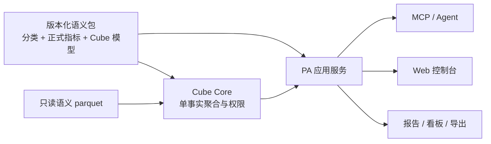

# PA — People Analytics Service

PA 是一个面向组织与人才数据的语义分析服务。它把人员规模、流动和编制等指标组织成受控的语义目录，让 Agent、控制台和 MCP 客户端通过“指标 × 维度 × 时间 × 过滤”查询，而不是直接生成 SQL。

仓库默认运行完全虚构、可重复生成的 Demo 数据，不依赖任何企业内部数据、字段映射或系统。

## 它展示什么

- 独立宽事实：Cube Core + DuckDB 直接聚合 parquet，不在原始事实之间做运行时 join。
- 正式指标图：跨事实比率由 TypeScript Planner 拆成查询腿，聚合后对齐并重算。
- 封闭查询面：MCP adapter 只做协议映射，不开放 SQL，也不接受临时指标定义。
- 权限先于语义装配：正式指标只有在全部叶子组件对当前身份可见时才进入目录。
- 同一应用核心，多套语义包：公开 Demo 与私有部署通过相同的声明合同装配，无需维护产品分叉。
- 分析工件：控制台与 MCP 共用报告、看板、呈现、导出和受控明细能力。



## 快速开始

需要 Docker、Bun、`uv` 和 Node.js。

1. 创建本地配置：

   ```sh
   cp .env.example .env
   ```

   将 `CUBEJS_API_SECRET` 改成随机值。只在本机体验时可设置 `PA_ALLOW_OPEN=1`；服务默认只绑定 `127.0.0.1`。

2. 生成确定性的虚构 parquet：

   ```sh
   uv run demo/generate_demo_data.py
   ```

3. 启动服务：

   ```sh
   docker compose up -d --build
   curl http://127.0.0.1:4000/readyz
   curl http://127.0.0.1:8788/healthz
   ```

4. 可选：为 Demo 账号播种报告、看板和通用业务术语：

   ```sh
   cd server
   bun run seed:demo -- demo@pa.local
   ```

控制台地址为 `http://127.0.0.1:8788/dashboard`，MCP Streamable HTTP 入口为 `http://127.0.0.1:8788/mcp`。

## 语义包：公开与内部差异的正式边界

部署只选择一个语义包目录。目录内必须包含：

```text
your_semantic_package/
├── semantic_package.yml   # schema 版本、业务分类、正式指标图
└── model/
    ├── cubes/             # 独立宽事实叶子模型
    └── views/             # 指标执行面与受控记录面
```

`semantic_package.yml` 是纯声明文件，不能执行代码。加载器会拒绝未知结构、重复身份、未登记指标域、缺失模型目录和逃逸包目录的路径。

公开版本默认使用 [`demo/`](./demo)。

## 数据合同

Cube 只读取 `$PA_SEMANTIC_DATA_DIR/current/*.parquet`。公开 Demo 生成器写入版本目录，校验完成后原子切换 `current`。

数据目录不进入 Git；`.gitignore` 已排除本地 parquet、数据库、密钥和环境配置。

## 开发

```sh
cd server
bun install
bun run check
```

常用的较快命令：

```sh
bun run typecheck
bun test
bun run build
bun run generate:data-capability-map
```

修改语义包时，至少运行包合同、模型暴露和能力地图测试。修改应用核心时，以 `bun run check` 为完整质量门禁。

提交改动前请阅读 [`CONTRIBUTING.md`](./CONTRIBUTING.md)。

## 目录

| 路径 | 用途 |
|---|---|
| `demo/` | 可公开的语义包、Cube 模型与确定性虚构数据生成器 |
| `server/src/semantic_core/` | 纯语义合同、时间合同和目录规格 |
| `server/src/engine/` | 语义包加载、正式指标 Planner、Executor、Calculator 与结果变换 |
| `server/src/application/` | MCP 与控制台共用的应用服务 |
| `server/src/composition/` | 应用服务、端口实现与运行依赖的集中装配 |
| `server/src/adapters/` | Cube 和网络等外部端口实现 |
| `server/src/mcp/` | MCP 工具与 Apps 资源映射 |
| `server/console/` | OAuth 登录、指标目录、分析、报告与看板 |
| `server/result_view/` | 控制台与 MCP widget 共用的结果渲染包 |
| `docs/` | 指标、时间、呈现、存储、UI 与代码质量规格 |

## 安全

安全问题请按 [`SECURITY.md`](./SECURITY.md) 中的方式私下报告。

## License

PA 使用 [Apache License 2.0](./LICENSE) 开源。仓库内改编代码的许可证见
[`docs/third_party_licenses.md`](./docs/third_party_licenses.md)。
